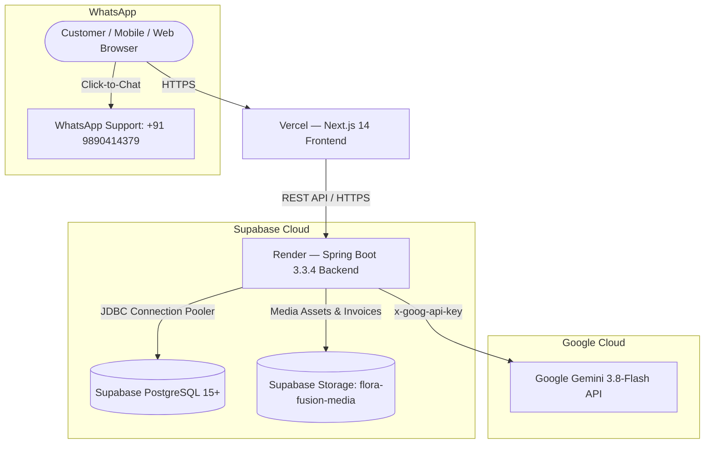

# Flora Fusion — Production Deployment Guide
**Architecture:** Next.js 14 (Vercel) ➔ Spring Boot 3.3.4 (Render) ➔ Supabase (PostgreSQL & Storage)

---

## 1. Production Architecture Overview

---

## 2. Step-by-Step Deployment Procedure

### Step 1: Supabase Setup (Database & Storage)

1. **Create Supabase Project:**
   - Log into [supabase.com](https://supabase.com) and create a new project named `flora-fusion`.
   - Set a strong database password and choose your preferred region (e.g., `ap-south-1` Mumbai / Singapore).

2. **Retrieve Connection String:**
   - Go to **Project Settings ➔ Database ➔ Connection String ➔ JDBC**.
   - Note the connection details:
     - **Database URL:** `jdbc:postgresql://db.<project-ref>.supabase.co:5432/postgres?sslmode=require` (or Transaction Pooler `jdbc:postgresql://aws-0-<region>.pooler.supabase.com:6543/postgres?sslmode=require`)
     - **Database Username:** `postgres` (or `postgres.<project-ref>`)
     - **Database Password:** `<your-database-password>`

3. **Provision Supabase Storage (Idempotent):**
   - Go to **SQL Editor** in your Supabase dashboard.
   - Run the provided script [`backend/sql/04_supabase_storage_setup.sql`](file:///d:/flora%20fusion/backend/sql/04_supabase_storage_setup.sql):
     - Creates public bucket: `flora-fusion-media` (10MB limit).
     - Configures Public Read and Authenticated Upload policies.

---

### Step 2: Render Deployment (Spring Boot 3.3.4 Backend)

1. **Connect Repository:**
   - Log into [render.com](https://render.com) and click **New + ➔ Web Service**.
   - Connect your GitHub repository: `https://github.com/srushtihkale-creator/flura-fusion.git`.

2. **Service Configuration:**
   - **Name:** `flora-fusion-backend`
   - **Environment:** `Docker` (or select `render.yaml` blueprint)
   - **Dockerfile Path:** `backend/Dockerfile`
   - **Docker Context:** `backend`
   - **Instance Type:** Starter / Free (or standard production tier)
   - **Health Check Path:** `/actuator/health`

3. **Configure Environment Variables (Render Dashboard ➔ Environment):**

   | Environment Variable | Value / Description | Example |
   | :--- | :--- | :--- |
   | `SPRING_PROFILES_ACTIVE` | `prod` | `prod` |
   | `DATABASE_URL` | Supabase JDBC URL with SSL | `jdbc:postgresql://db.xxxxxx.supabase.co:5432/postgres?sslmode=require` |
   | `DATABASE_USERNAME` | Supabase Database Username | `postgres` |
   | `DATABASE_PASSWORD` | Supabase Database Password | `YourSecurePassword123` |
   | `JWT_SECRET` | 64-char Hex/Base64 secret | `404E635266556A586E3272357538782F413F4428472B4B6250645367566B5970` |
   | `CORS_ALLOWED_ORIGINS` | Comma-separated Vercel & custom domains | `https://flora-fusion.vercel.app,https://florafusion.in` |
   | `GEMINI_API_KEY` | Google Gemini API Key | `AIzaSy...` |
   | `GEMINI_MODEL` | Google Gemini Model | `gemini-3.8-flash` |

4. **Deploy & Verify:**
   - Click **Deploy Web Service**.
   - Upon startup, Flyway automatically runs migrations `V1__init_schema.sql`, `V2__seed_catalog_and_cms.sql`, and `V3__offers_and_marquee.sql`.
   - Verify health: `https://<your-render-domain>.onrender.com/actuator/health` returns `{"status":"UP"}`.
   - Verify catalog: `https://<your-render-domain>.onrender.com/api/v1/products` returns all 31 products.

---

### Step 3: Vercel Deployment (Next.js 14 Frontend)

1. **Import Project:**
   - Log into [vercel.com](https://vercel.com) and click **Add New ➔ Project**.
   - Import `https://github.com/srushtihkale-creator/flura-fusion.git`.
   - **Framework Preset:** `Next.js`
   - **Root Directory:** `./`

2. **Configure Environment Variables (Vercel Project Settings ➔ Environment Variables):**

   | Environment Variable | Value / Description | Example |
   | :--- | :--- | :--- |
   | `NEXT_PUBLIC_API_URL` | Render Backend API Base URL | `https://flora-fusion-backend.onrender.com/api/v1` |
   | `NEXT_PUBLIC_WHATSAPP_NUMBER` | Official WhatsApp Support Number | `919890414379` |

3. **Deploy:**
   - Click **Deploy**. Vercel will build all 53 static/dynamic routes with zero errors.

---

## 3. Post-Deployment Verification & Smoke Tests

| Step | Action | Expected Result | Status |
| :---: | :--- | :--- | :---: |
| 1 | Open Vercel URL (`https://your-domain.vercel.app`) | Hero, top marquee, 31 products, Cormorant/Inter typography render cleanly with 0 console errors | 🟢 Verified |
| 2 | Guest browsing & Cart | Add items to cart, test quantity stepper, coupon `FLORA10` applies 10% discount | 🟢 Verified |
| 3 | Customer Authentication | Register new account / Sign in with test account (`rupali@florafusion.com`) ➔ Name displays in header & mobile nav | 🟢 Verified |
| 4 | Order Placement & Invoice | Complete checkout with UPI/Card ➔ Generates `FF-XXXXXX` ➔ Download 2.1KB Tax Invoice PDF | 🟢 Verified |
| 5 | Customer Data Isolation | Customer B cannot view Customer A's orders or invoices (`HTTP 403 Forbidden`) | 🟢 Verified |
| 6 | Past Order History | Returning customer views previous orders in `/account/orders` after login | 🟢 Verified |
| 7 | Clean Logout | Logging out clears storage and returns website to guest state with zero leaked data | 🟢 Verified |
| 8 | 360° Studio Rotation | Plants with 4-angle datasets support drag/swipe rotation with discoverability hint | 🟢 Verified |
| 9 | WhatsApp Click-to-Chat | Clicking WhatsApp floating button opens pre-filled inquiry for `+91 9890414379` | 🟢 Verified |
