# Flora Fusion — Entity Relationship Diagram (ERD) & Schema Specification

> **Document Status:** Implementation Source of Truth  
> **Database:** PostgreSQL 14+ / Supabase PostgreSQL  
> **Source:** [`DOCS/Flora_Fusion_SRS_FINAL.md`](file:///d:/flora%20fusion/DOCS/Flora_Fusion_SRS_FINAL.md)

---

## 1. Visual Entity Relationship Diagram (ERD)

```mermaid
erDiagram
    users ||--o{ addresses : "has"
    users ||--o| carts : "owns"
    users ||--o| wishlists : "owns"
    users ||--o{ orders : "places"
    users ||--o{ reviews : "writes"
    users ||--o{ ai_visualizations : "generates"

    categories ||--o{ products : "contains"
    products ||--o{ product_images : "has"
    products ||--o{ cart_items : "added_to"
    products ||--o{ wishlist_items : "saved_in"
    products ||--o{ order_items : "ordered_as"
    products ||--o{ reviews : "receives"
    products ||--o{ discount_products : "discounted_by"

    carts ||--o{ cart_items : "contains"
    wishlists ||--o{ wishlist_items : "contains"
    orders ||--|{ order_items : "contains"
    discounts ||--o{ discount_products : "applies_to"

    users {
        UUID id PK
        VARCHAR name
        VARCHAR email UK
        VARCHAR phone
        VARCHAR password_hash
        VARCHAR role "CUSTOMER | ADMIN"
        VARCHAR status "ACTIVE | SUSPENDED"
        TIMESTAMPTZ created_at
        TIMESTAMPTZ updated_at
    }

    addresses {
        UUID id PK
        UUID user_id FK
        VARCHAR full_name
        VARCHAR phone
        TEXT address_line
        VARCHAR city
        VARCHAR state
        VARCHAR pincode
        BOOLEAN is_default
    }

    categories {
        UUID id PK
        VARCHAR name
        VARCHAR slug UK
        TEXT description
        VARCHAR image_url
        INT display_order
        BOOLEAN is_active
    }

    products {
        UUID id PK
        UUID category_id FK
        VARCHAR sub_category
        VARCHAR name
        VARCHAR slug UK
        VARCHAR tagline
        TEXT description
        VARCHAR sku UK
        DECIMAL base_price
        DECIMAL original_price
        DECIMAL rating
        INT review_count
        VARCHAR badge
        BOOLEAN in_stock
        INT stock_quantity
        JSONB metadata
        JSONB care_guide
        VARCHAR status "ACTIVE | INACTIVE"
    }

    product_images {
        UUID id PK
        UUID product_id FK
        VARCHAR media_url
        VARCHAR media_type "PRIMARY | GALLERY | ANGLE_360 | OTHER"
        INT sort_order
        VARCHAR alt_text
    }

    carts {
        UUID id PK
        UUID user_id FK
        TIMESTAMPTZ updated_at
    }

    cart_items {
        UUID id PK
        UUID cart_id FK
        UUID product_id FK
        INT quantity
    }

    wishlists {
        UUID id PK
        UUID user_id FK
    }

    wishlist_items {
        UUID id PK
        UUID wishlist_id FK
        UUID product_id FK
    }

    coupons {
        UUID id PK
        VARCHAR code UK
        VARCHAR discount_type "PERCENTAGE | FIXED_AMOUNT"
        DECIMAL discount_value
        DECIMAL min_cart_value
        DECIMAL max_discount
        INT usage_limit
        INT times_used
        TIMESTAMPTZ start_date
        TIMESTAMPTZ end_date
        BOOLEAN is_active
    }

    discounts {
        UUID id PK
        VARCHAR name
        VARCHAR discount_type
        DECIMAL discount_value
        DECIMAL min_cart_value
        DECIMAL max_discount
        BOOLEAN is_active
    }

    discount_products {
        UUID discount_id PK,FK
        UUID product_id PK,FK
    }

    orders {
        UUID id PK
        UUID user_id FK "nullable for guest"
        VARCHAR guest_email "nullable"
        VARCHAR order_number UK
        DECIMAL subtotal
        DECIMAL discount_amount
        DECIMAL shipping_amount
        DECIMAL tax_amount
        DECIMAL total_amount
        VARCHAR payment_method
        VARCHAR payment_status "PENDING | COMPLETED | FAILED"
        VARCHAR payment_transaction_id
        VARCHAR order_status "Placed | Confirmed | Packed | Dispatched | Out for Delivery | Delivered"
        JSONB shipping_address_snapshot
        VARCHAR idempotency_key UK
        JSONB tracking_milestones
        TIMESTAMPTZ created_at
    }

    order_items {
        UUID id PK
        UUID order_id FK
        UUID product_id FK "nullable"
        VARCHAR product_name_snapshot
        VARCHAR sku_snapshot
        VARCHAR product_image_snapshot
        VARCHAR category_snapshot
        INT quantity
        DECIMAL unit_price
        DECIMAL discount_amount
        DECIMAL line_total
    }

    reviews {
        UUID id PK
        UUID product_id FK
        UUID user_id FK
        INT rating
        TEXT review_text
        VARCHAR status "PENDING | APPROVED | REJECTED"
        TIMESTAMPTZ created_at
    }

    cms_banners {
        UUID id PK
        VARCHAR slot_key UK
        VARCHAR title
        VARCHAR subtitle
        VARCHAR eyebrow
        VARCHAR cta_text
        VARCHAR cta_link
        VARCHAR image_url
        BOOLEAN is_active
        INT display_order
    }

    cms_pages {
        UUID id PK
        VARCHAR slug UK
        VARCHAR title
        VARCHAR category
        VARCHAR author
        VARCHAR reading_time
        VARCHAR cover_image
        TEXT excerpt
        TEXT content_markdown
        BOOLEAN is_published
    }

    ai_visualizations {
        UUID id PK
        UUID user_id FK
        VARCHAR guest_identifier
        VARCHAR input_image_url
        TEXT prompt_text
        JSONB selected_product_ids
        VARCHAR output_image_url
        VARCHAR status "COMPLETED"
    }
```

---

## 2. Key Data Integrity & Security Rules

1. **Guest Checkout Isolation:** `orders.user_id` is nullable. When a guest checks out, `guest_email` and `shipping_address_snapshot` record the customer details without requiring account creation.
2. **Historical Order Snapshots:** `order_items` stores copies of `product_name_snapshot`, `sku_snapshot`, `unit_price`, and `line_total` at the exact instant of purchase. If a product's price or name is updated in the CMS, past orders remain 100% immutable.
3. **Multi-Angle Studio Gallery Support:** Products link to multiple `product_images` with `media_type`:
   - `PRIMARY`: Default 1:1 studio crop.
   - `ANGLE_360`: 4 verified studio angle frames (Front, Right, Back, Left) for direct main-image drag/swipe rotation.
   - `GALLERY`: Additional studio showcases.
4. **Idempotency Protection:** `orders.idempotency_key` ensures that repeated network clicks or browser retries never trigger double-charging or duplicate order creation.
