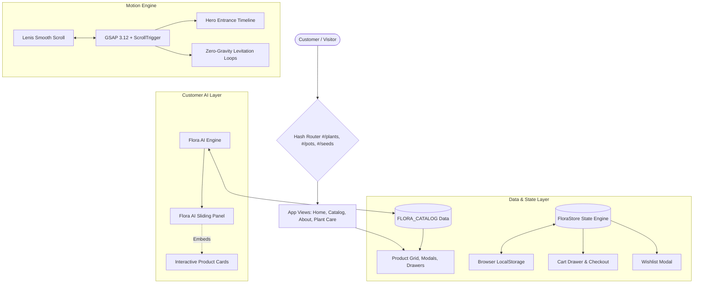
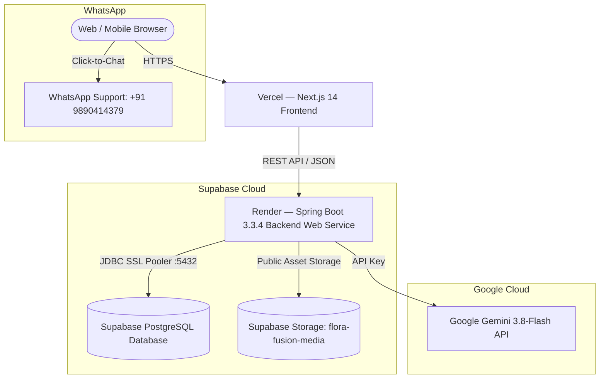

# Flora Fusion — Technical Architecture & Engineering Documentation

> **System:** Flora Fusion E-Commerce Frontend Prototype  
> **Brand Line:** *Nature Meets Your Space*  
> **Technology Stack:** HTML5 · Vanilla CSS (Tokenized) · Vanilla JavaScript (ES6+) · GSAP 3.12 · Lenis Smooth Scroll

---

## 1. Architectural Overview

Flora Fusion is engineered as a high-performance, single-page application (SPA) built purely with standard web technologies. It avoids bulky framework dependencies while delivering an editorial, app-like experience for an Indian plant nursery lifestyle brand.



### Key Architectural Tenets
1. **Zero Framework Overhead:** Pure HTML5, modern tokenized CSS, and modular Vanilla JS for instantaneous load times and zero compilation latency.
2. **State Continuity via SPA:** Hash routing (`#/plants`, `#/product/:slug`, `#/checkout`) ensures that switching between categories, reading plant care guides, or opening products does not trigger a page reload, preserving ongoing Flora AI conversations and active cart items.
3. **Local Storage Synchronization:** Cart contents, active coupons, saved wishlist items, and placed orders are automatically serialized to `localStorage`.
4. **Strict Customer-Facing AI:** Flora AI acts exclusively as a botanical shopping guide, retrieving verified product records and formatting interactive mini product cards directly inside the conversation stream.

---

## 2. Directory & File Organization

```text
d:/flora fusion/
├── DOCS/
│   ├── Flora_Fusion_prompt.md               # Original build specification prompt
│   ├── Flora_Fusion_design_tokens (1).md    # Design token source of truth
│   ├── flora fusion.png                     # Visual layout reference
│   ├── flura fusion catlog.png              # Complete catalog reference
│   └── ChatGPT Image Sep 30, 2026, 03_07_48 PM.png # Latest Home Page visual reference
├── assets/
│   ├── logo.png                             # Exact provided Flora Fusion brand logo
│   ├── hero/
│   │   ├── hero_lush.jpg                    # High-res arched window room hero photo
│   │   └── hero_banner.png                  # Clean hero visual asset
│   ├── banners/
│   │   ├── promo_plants.png                 # Reference category banner for plants
│   │   ├── promo_pots.png                   # Reference category banner for pots
│   │   └── promo_seeds.png                  # Reference category banner for seeds
│   └── products/
│       ├── plants/                          # 11 studio photos + reference crops (Monstera, Snake, Lily, Palm, ZZ)
│       ├── pots/                            # 10 studio photos + reference crops (Ribbed, Minimal White)
│       └── seeds/                           # 10 studio photos + reference crops (Basil Seeds)
├── styles/
│   ├── tokens.css                           # Design tokens (:root variables)
│   ├── base.css                             # Reset, typography, Lenis styles
│   ├── components.css                       # Header, cards, modals, drawers, footer
│   ├── responsive.css                       # Mobile bottom nav, 2-column grid, sheets
│   └── animations.css                       # GSAP utility classes & keyframes
├── js/
│   ├── data.js                              # Catalog dataset (31 items with full specs)
│   ├── store.js                             # Cart, Wishlist, Coupon, Order & Toast state
│   ├── ai.js                                # Flora AI botanical assistant logic
│   ├── animations.js                        # GSAP timelines, Lenis sync & levitation
│   └── app.js                               # Router, UI rendering, event delegation
├── progress.md                              # Milestone and delivery tracker
├── technical.md                             # Architecture & technical documentation
└── index.html                               # Semantic single-page application entry
```

---

## 3. Design System & Token Mapping

All visual properties adhere strictly to [Flora_Fusion_design_tokens (1).md](file:///d:/flora%20fusion/DOCS/Flora_Fusion_design_tokens%20%281%29.md):

### 3.1 Color Palette Tokens
| Token Variable | Hex Value | Semantic Role |
| :--- | :--- | :--- |
| `--color-brand-forest` | `#173F2B` | Primary buttons, brand logo, strong headings, active chips |
| `--color-brand-green` | `#24583B` | Secondary buttons, link hovers, active borders, leaves |
| `--color-brand-deep` | `#123222` | Price typography, high-contrast footer, toasts |
| `--color-brand-sage` | `#A9BDA3` | Secondary backgrounds, filter chips, decorative foliage |
| `--color-brand-sage-light` | `#DDE7D8` | Soft highlights, badge backgrounds, tag chips |
| `--color-cream` | `#F7F4EC` | Master page background |
| `--color-cream-soft` | `#FBF9F4` | Card image backgrounds, modal drawer body |
| `--color-beige` | `#EEE8DA` | Warm promotional card backgrounds |
| `--color-sand` | `#DCC8A8` | Accent borders and terracotta highlights |
| `--color-white` | `#FFFFFF` | Product cards, modals, search inputs |
| `--color-category-plants` | `#315F3F` | Plants promo card accent |
| `--color-category-pots` | `#B9825B` | Pots promo card terracotta accent |
| `--color-category-seeds` | `#718B55` | Seeds promo card sprout accent |

### 3.2 Typography Tokens
* **Display / Headings:** `"Cormorant Garamond", Georgia, serif`
  * Hero Title: `clamp(2.75rem, 5vw, 4.5rem)`
  * Section Title (`h2`): `clamp(1.4rem, 2vw, 2rem)`
  * Editorial weight: `400` (regular), `500` (medium), `600` (semi-bold)
* **Interface / Body Text:** `"Inter", -apple-system, BlinkMacSystemFont, "Segoe UI", Roboto, sans-serif`
  * Body regular: `1rem` (16px), line-height: `1.6`
  * Small body / Card descriptions: `0.8125rem` (13px)
  * Metadata / Badges / Labels: `0.6875rem` (11px) – `0.75rem` (12px)

### 3.3 Elevation & Shadows
* `--shadow-xs`: `0 1px 3px rgba(23, 63, 43, 0.05)`
* `--shadow-sm`: `0 4px 12px rgba(23, 63, 43, 0.07)` (Product cards default)
* `--shadow-md`: `0 10px 28px rgba(23, 63, 43, 0.10)` (Card hover & floating badges)
* `--shadow-lg`: `0 18px 45px rgba(23, 63, 43, 0.13)` (Modals & cart drawer)
* `--shadow-floating`: `0 20px 40px -10px rgba(23, 63, 43, 0.18)` (AI floating button)

---

## 4. Data Layer & Schemas

### 4.1 Product Schema (`js/data.js`)
```typescript
interface Product {
  id: string;               // e.g. "plant-1"
  category: "plants" | "pots" | "seeds";
  subCategory: string;      // e.g. "indoor", "ceramic", "herb"
  name: string;             // e.g. "Money Plant"
  slug: string;             // e.g. "money-plant"
  tagline: string;          // e.g. "Brings good luck & positivity"
  description: string;      // Full editorial description
  price: number;            // Current selling price (INR)
  originalPrice?: number;   // Strikethrough price if discounted
  rating: number;           // e.g. 4.8
  reviewCount: number;      // e.g. 124
  image: string;            // Path to HD 800x800 image
  refImage: string;         // Path to reference crop
  badge?: string | null;    // "Bestseller" | "Trending" | "Classic" | null
  inStock: boolean;
  metadata: PlantMetadata | PotMetadata | SeedMetadata;
  careGuide?: {
    watering: string;
    sunlight: string;
    repotting: string;
    proTip: string;
  };
}

interface PlantMetadata {
  placement: string;        // "Indoor" | "Outdoor"
  water: string;            // "Low Water" | "Medium Water"
  light: string;            // "Indirect Sun" | "Full Sun"
  difficulty: string;       // "Easy for Beginners" | "Hardy"
  airPurifying: boolean;
  petFriendly: boolean;
  size: string;
}

interface PotMetadata {
  material: string;         // "High-fired Ceramic" | "Terracotta"
  size: string;             // "8 inch diameter"
  drainage: string;         // "Includes drainage hole + plug"
  style: string;
  colors: string[];
}

interface SeedMetadata {
  type: string;             // "Herb Seeds" | "Vegetable Seeds"
  difficulty: string;
  season: string;
  germination: string;      // "5-8 Days"
  harvestTime: string;      // "4-5 Weeks"
  seedCount: string;
}
```

### 4.2 Cart & Order State Schema (`js/store.js`)
```typescript
interface CartItem {
  id: string;
  name: string;
  price: number;
  image: string;
  category: string;
  quantity: number;
  options: Record<string, any>;
}

interface Order {
  orderId: string;          // Format: "FF-XXXXXX"
  date: string;
  timestamp: number;
  items: CartItem[];
  subtotal: number;
  shipping: number;         // 0 if subtotal >= 799 else 79
  discount: number;         // Calculated from active coupon
  total: number;
  address: {
    name: string;
    phone: string;
    address: string;
    city: string;
    pincode: string;
  };
  paymentMethod: "UPI" | "Card" | "NetBanking" | "COD";
  status: "Placed" | "Confirmed" | "Packed" | "Shipped" | "Delivered";
  estimatedDelivery: string;
  trackingSteps: Array<{ label: string; time: string; completed: boolean }>;
}
```

---

## 5. Component Breakdown & Interaction Flows

### 5.1 Single-Page Router (`js/app.js`)
* Listens to the `hashchange` event on the `window` object.
* Supports routes:
  * `#/` ➔ Activates `#home-view` (Hero, Trust strip, Category Promos, Featured Grids).
  * `#/plants` ➔ Activates `#catalog-view` with Plants category, title, and filter chips.
  * `#/pots` ➔ Activates `#catalog-view` with Pots category and filter chips.
  * `#/seeds` ➔ Activates `#catalog-view` with Seeds category and filter chips.
  * `#/about` ➔ Activates `#about-view` (Brand story and sustainability).
  * `#/plant-care` ➔ Activates `#care-view` (Watering and lighting guide).
  * `#/checkout` ➔ Opens the Checkout Stepper modal.
  * `#/tracking` ➔ Opens the Live Order Tracking modal.

### 5.2 Flora AI Assistant (`js/ai.js`)
* **Floating Launcher:** Styled with a pulsing concentric ring (`@keyframes pulse-ring`) and slow-wobbling leaf SVG.
* **Knowledge Retrieval:** Matches customer queries against botanical intent keywords (low light, under 500, beginner, watering, pots, herbs).
* **Interactive Chat Cards:** Generates dynamic HTML product cards inside the conversation bubble. Customers can click *"View"* to open the product modal or *"Add to Cart"* to immediately update their cart.
* **Typing Simulation:** Emits a 3-dot bouncing pulse indicator before responding to feel responsive and natural.

### 5.3 Cart Drawer & Checkout Stepper
* **Cart Calculations:**
  $$\text{Subtotal} = \sum (\text{item.price} \times \text{item.quantity})$$
  $$\text{Shipping} = \begin{cases} 0 & \text{if Subtotal} \ge 799 \\ 79 & \text{if Subtotal} < 799 \end{cases}$$
  $$\text{Discount} = \text{Coupon Rate} \times \text{Subtotal}$$
  $$\text{Total} = \text{Subtotal} + \text{Shipping} - \text{Discount}$$
* **Free Delivery Progress Bar:** Visual SVG track filled dynamically by $\min(100, \frac{\text{Subtotal}}{799} \times 100)\%$.
* **Coupon Engine:** Validates codes like `FLORA10` (10% off) or `NATURE20` (20% off for orders > ₹1000).
* **Checkout Stepper:** 3-step sequence (Address ➔ Delivery speed ➔ Payment). Upon submission, saves order to `localStorage`, flushes cart, and triggers the confirmation modal with live tracking.

---

## 6. Motion & Smooth Scrolling Engine (`js/animations.js`)

### 6.1 Lenis Smooth Inertia Scroll
* Configured with an exponential decay curve: `easing: (t) => Math.min(1, 1.001 - Math.pow(2, -10 * t))`.
* Ticker hook: `gsap.ticker.add((time) => lenis.raf(time * 1000))` ensures ScrollTrigger calculations match the interpolated scroll position without layout jitter.

### 6.2 Zero-Gravity Levitation
* Hero floating leaves and nursery badge apply subtle, asynchronous sinusoidal tweens:
  ```javascript
  gsap.to(leafElement, {
    y: -12,
    x: 6,
    rotation: 4,
    duration: 3.6,
    ease: "sine.inOut",
    repeat: -1,
    yoyo: true
  });
  ```

### 6.3 Accessibility (`prefers-reduced-motion`)
* Checks `window.matchMedia('(prefers-reduced-motion: reduce)').matches`.
* Automatically disables Lenis interpolation, cancels infinite GSAP loops, and uses instantaneous CSS opacity transitions when active.

---

## 7. Performance & Quality Benchmarks

1. **Asset Optimization:** All 31 product images are locally served at `800×800px` WebP/JPEG format with lazy loading (`loading="lazy"`).
2. **Event Delegation:** Clicks on product grids and card buttons are handled through central event delegation in `js/app.js` to minimize listener overhead.
3. **No Layout Shift (CLS):** Every product card image container maintains a fixed `aspect-ratio: 1 / 1` with a soft cream skeleton placeholder to prevent cumulative layout shifts during asset rendering.

---

## 8. Footer Rotating Botanical Badges System (`index.html`, `js/animations.js`)

### 8.1 Visual & Structural Specifications
* **Placement:** Full-width strip placed directly beneath the sub-footer legal links row (`.subfooter-badges-strip`).
* **Geometry:** Edge-to-edge row of overlapping circular badges (`width: 116px; height: 116px; margin: 0 -12px;` on desktop; `84px` on mobile with `overflow-x: hidden`).
* **Aesthetic Palette:** Alternating tri-color sequence adhering to design tokens:
  1. Forest Green (`#173F2B`) with soft sage emblem and cream typography.
  2. Warm Cream (`#FBF9F4`) with deep green emblem and botanical border ring.
  3. Soft Blush Terracotta (`#F1E1D4`) with organic sprig motif and warm earthy typography.
* **Typographic Perimeter:** Vector-wrapped text paths utilizing brand mottos (*"NATURE LOOKS GOOD ON YOU"*, *"PLANTS FOR A GREENER TOMORROW"*, *"GROW GOOD VIBES"*, *"NATURE IN EVERY HOME"*).

### 8.2 GSAP Rotation Mechanics & Tactile Interactivity
* **Individual Rotation Tweens:** Each circle badge rotates independently around its own `transform-origin: center center`.
  ```javascript
  gsap.to(badge, {
    rotation: direction * 360,
    duration: gsap.utils.random(22, 38),
    ease: "none",
    repeat: -1
  });
  ```
* **Click/Tap Tactile Acceleration:** Clicking or tapping any individual badge triggers an immediate `360°` spin tween (`duration: 0.85s`, `ease: "power2.out"`). Upon completion, the badge smoothly resumes its background rotation loop.
* **Reduced Motion Compliance:** If `prefers-reduced-motion: reduce` is active, rotation tweens are disabled, rendering the badges statically with subtle hover elevations.

---

## 9. Home Page Reference Image Pipeline (`DOCS/ChatGPT Image Sep 30, 2026, 03_07_48 PM.png`)

To maintain fidelity with the reference mockup without introducing visual noise, a non-destructive image extraction and inpainting pipeline was executed:

1. **Hero Main Image (`assets/hero/hero_lush.jpg` & `hero_banner.png`):**
   - Source bounds: `x: 528..1205, y: 45..442` (677×397px).
   - Cleaned the foreign webpage UI "Scroll Down" vertical pill by linear horizontal color interpolation of the warm beige wall gradient.
   - Preserves the sunlit arched window, pedestal planters, and the circular "Nature Looks Good On You" badge.
2. **Category Promotional Banners (`assets/banners/promo_*.png`):**
   - Extracted exact 172×98px crops for Plants (soft sage), Pots (warm beige), and Seeds (cream kraft packets with organic soil).
   - Inpainted outer container rounded border corners using local background sampling (`#DFE8DC`, `#F3ECE2`, `#F6F3EB`).
3. **Featured / Best Seller Product Crops (`assets/products/plants/`):**
   - Extracted 168×120px studio crops for Monstera Deliciosa, Snake Plant, Peace Lily, Areca Palm, and ZZ Plant.
   - Inpainted foreign UI wishlist heart badges and outer card border curves using the solid cream studio background (`#F8F7F0`).
   - Saved simultaneously as production `.jpg` and fallback `-ref.png` assets.
4. **Architectural Guardrails Maintained:**
   - Zero modifications to HTML layout hierarchy, components, or section structure.
   - Zero changes to `design_tokens.md` or CSS custom properties.
   - Zero changes to product catalog pricing, ratings, or state logic in `js/data.js` and `js/store.js`.
   - Exact brand logo asset (`assets/logo.png`) retained across all viewports.

---

## 10. Feature Card Anti-Gravity Floating Animation & Hero Restoration

### 10.1 Feature Cards Floating Motion (`styles/animations.css`, `styles/components.css`)
* **Target Elements:** The four trust feature cards (`.trust-item`): Healthy Plants, Safe & Secure, Fast & Reliable, Expert Support.
* **Pure CSS Keyframe Mechanics:**
  - Alternating keyframe sequences (`antiGravityFloatA` clockwise tilt, `antiGravityFloatB` counter-clockwise tilt).
  - Smooth vertical float: `translateY(0px)` to `translateY(-12px)`.
  - Subtle zero-gravity rotation: `-1deg` to `1deg`.
  - Infinite loops with smooth cubic-bezier / ease-in-out easing over `3.6s` – `4.0s`.
  - Staggered timing offsets (`0s`, `0.8s`, `1.6s`, `2.4s`) across `:nth-child(1..4)` ensuring organic out-of-sync levitation.
  - Dynamic height-simulating box-shadow: softens and expands as card rises (`0 4px 12px rgba(23,63,43,0.05)` ➔ `0 18px 28px rgba(23,63,43,0.11)`).
* **Hover Interaction:**
  - Smooth handoff (`transition: transform 0.4s, box-shadow 0.4s`).
  - Elevated lift (`translateY(-16px)`), subtle scale (`scale(1.03)`), deeper botanical shadow (`0 20px 36px rgba(23,63,43,0.16)`), and float pausing (`animation-play-state: paused`).
* **Accessibility:** Full `@media (prefers-reduced-motion: reduce)` override disables all transforms and animations.

### 10.2 Original Opening Hero Section Restoration (`index.html`, `styles/components.css`, `assets/hero/`)
* **Hero Editorial Copy:** Restored authentic opening copy matching the original specification:
  - Eyebrow: `🍃 GREEN SPACES. HAPPIER PLACES.`
  - Title: `Bring Nature Home`
  - Supporting description: *"Discover a wide range of healthy plants, beautiful pots and quality seeds — all in one place."*
  - CTA Button: `Shop Now →` linking to `#/plants`.
* **Original Plant Photography:** Restored authentic high-definition plant composition (`assets/hero/hero_lush.jpg`, `assets/hero/hero_banner.png`) showcasing snake plant, pothos, and textured planters on a wooden table.
* **Desktop Cleanliness:** Configured `.mobile-search-row { display: none; }` on desktop viewports (active only at `@media (max-width: 768px)`), ensuring the Hero section sits immediately at the top of the Home Page under the header.
* **Component Integrity:** Preserved all existing sections (Plants, Pots, Seeds, Promo Banners, Customer Flora AI, Footer, Rotating Badges, Modals) with zero regressions.

---

## 11. Next.js 14 App Router Migration & 100% Prototype UI/UX Realignment

### 11.1 Framework & Stack Specification
- **Framework:** Next.js 14.2.x (App Router, React Server Components + Client Boundary islands).
- **Language:** TypeScript 5.x with strict type checking enabled (`strict: true`, zero `any` leaks).
- **State Management:** Zustand with `persist` middleware (`src/store/useFloraStore.ts`) synchronizing Cart, Wishlist, Coupons, and Order history across sessions.
- **Motion Engine:** GSAP 3.12 (with ScrollTrigger) & `@studio-freight/lenis` smooth inertia scrolling wrapped in SSR-safe `useSmoothScroll` hook.
- **Repository Remote:** `https://github.com/srushtihkale-creator/flura-fusion.git` (`origin/main`).

### 11.2 Style Architecture & 100% Prototype Parity
The Next.js application imports the exact CSS hierarchy from the verified prototype:
1. `src/styles/tokens.css`: All CSS custom properties, color tokens, typography scales, z-indices, easings, plus layout variables (`--header-bg`, `--footer-bg`, `--footer-border`, `--footer-padding-desktop`, `--drawer-width`, `--bottom-nav-bg`).
2. `src/styles/base.css`: Global HTML/body reset, Cormorant Garamond / Inter font assignments, and `.container` wrapper rules.
3. `src/styles/components.css`: 2,098 lines of meticulously styled components including `.site-header`, `.hero-section`, `.trust-strip`, `.product-grid`, `.product-card`, `.promo-banners-section`, `.cart-drawer`, `.drawer-backdrop`, `.flora-ai-panel`, `.site-footer`, and `.site-subfooter`.
4. `src/styles/responsive.css`: Breakpoint rules for mobile bottom nav, 2-column mobile catalog grids, responsive drawers, and search rows.
5. `src/styles/animations.css`: Keyframes for levitation (`antiGravityFloatA`, `antiGravityFloatB`), typing dots, and pulses.

### 11.3 Component Realignment Mapping
| Component | Prototype DOM Hierarchy & Classes | Features & Micro-Interactions |
| :--- | :--- | :--- |
| `SiteHeader.tsx` | `.site-header > .container > .brand-logo, .nav-links, .header-search, .header-actions` | Search dropdown, reactive badge counters, logo asset |
| `HeroSection.tsx` | `.hero-section > .container.hero-grid > .hero-text-content, .hero-visual-wrapper` | Floating SVG leaves, main hero card, nursery badge |
| `TrustStrip.tsx` | `.trust-strip > .container.trust-grid > .trust-item` | 4 cards, minimal SVG line icons, out-of-sync levitation |
| `FeaturedCatalogSections.tsx` | `section.container > .home-section-header, .home-filter-chips, .product-grid` | Category badges, filter chips, all 31 items SSR rendered |
| `CategoryBanners.tsx` | `.promo-banners-section > .container.promo-grid > .promo-card` | Plants, Pots, Seeds promo cards with background images |
| `ProductCard.tsx` | `.product-card > .product-img-wrapper, .product-name, .product-meta-row, .card-quick-add` | Wishlist heart toggle, botanical tags, hover lift |
| `CartDrawer.tsx` | `.drawer-backdrop, .cart-drawer > .drawer-header, .drawer-body, .drawer-footer` | Free delivery progress bar, coupon form, total summary |
| `WishlistModal.tsx` | `.modal-backdrop, .modal-container > .product-grid` | Modal backdrop blur, empty state, saved item grid |
| `FloraAIPanel.tsx` | `.flora-ai-launcher, .drawer-backdrop, .flora-ai-panel` | Pulsing leaf trigger, suggestion chips, interactive cards |
| `SiteFooter.tsx` | `.site-footer > .container > .footer-grid` | Brand description, collection links, newsletter subscription |
| `SubFooter.tsx` | `.site-subfooter > .container.subfooter-inner` | Legal links, dynamic copyright, accessible policy modals |
| `RotatingBadgeStrip.tsx` | `.overlapping-badges-strip > .overlapping-badges-track > .overlapping-badge-item` | Overlapping badges, alternating GSAP spin loops, click-spin |
| `MobileNav.tsx` | `.mobile-bottom-nav > .mobile-nav-items > .mobile-nav-btn` | Sticky bottom navigation bar with active route highlight |

### 11.4 SSR Hydration & Verification Engine
- Direct SSR hydration without blank-screen flicker; all 31 products and drawer/modal DOM nodes exist in the server-rendered HTML payload.
- Validated via direct HTTP request: `http://localhost:3000` returns HTTP 200 with 93,869 bytes of clean HTML confirming all 17 prototype classes present.
- Production bundle verification (`npm run build`) generates static prerendered routes with zero build or lint warnings.

---

## 12. Complete Routing, Domain Services & Production Delivery (Phases 4–15)

### 12.1 End-to-End Application Routes
| Route | Page Component | Rendering Strategy | Key Capabilities |
| :--- | :--- | :--- | :--- |
| `/` | `src/app/page.tsx` | Static (`SSG`) | Hero, trust strip, featured categories, promo banners, stories |
| `/plants` | `src/app/plants/page.tsx` | Static (`SSG`) | 11 Plants, category hero banner, filters, sort, quick search |
| `/pots` | `src/app/pots/page.tsx` | Static (`SSG`) | 10 Pots, material filters (ceramic, terracotta, etc.), sort |
| `/seeds` | `src/app/seeds/page.tsx` | Static (`SSG`) | 10 Seeds, type filters (herb, vegetable, flower), germination info |
| `/product/[slug]` | `src/app/product/[slug]/page.tsx` | Statically Generated (`31 paths`) | HD gallery, botanical specs, care guide, Add to Cart, Buy Now |
| `/search` | `src/app/search/page.tsx` | Dynamic / Client Suspense | Real-time debounced query, category tabs, suggestions, empty state |
| `/cart` | `src/app/cart/page.tsx` | Static (`SSG`) | Free shipping progress (₹799), coupon engine, summary, checkout CTA |
| `/wishlist` | `src/app/wishlist/page.tsx` | Static (`SSG`) | Saved wishlist items, Section 25 empty state, 1-click cart move |
| `/checkout` | `src/app/checkout/page.tsx` | Static (`SSG`) | 3-step checkout stepper (Address, Delivery Speed, Payment) |
| `/account` | `src/app/account/page.tsx` | Static (`SSG`) | Customer profile, stats, recent order, saved addresses |
| `/account/orders` | `src/app/account/orders/page.tsx` | Static (`SSG`) | Orders list with status badges, order dates, and tracking links |
| `/account/orders/[id]` | `src/app/account/orders/[id]/page.tsx` | Server-Rendered on demand | 6-stage live visual tracking timeline, order invoice details |
| `/plant-care` | `src/app/plant-care/page.tsx` | Static (`SSG`) | Knowledge hub, topic filter chips, arborist guidance |
| `/plant-care/[slug]` | `src/app/plant-care/[slug]/page.tsx` | Statically Generated (`5 paths`) | Full article markdown reader, care illustrations, Flora AI trigger |
| `/about` | `src/app/about/page.tsx` | Static (`SSG`) | Botanical nursery story, sustainability values, philosophy |
| `/flora-ai` | `src/app/flora-ai/page.tsx` | Static (`SSG`) | Full-page customer assistant, suggestion chips, interactive cards |

### 12.2 Domain Service Layer Architecture (`src/services/`)
Adhering to `frontendprompt.md` Section 5 & 26:
- **`ProductService.ts`**: Pure abstraction for catalog retrieval, subcategory filtering, sorting (`price-low`, `price-high`, `rating`, `featured`), slug lookups, and related-product cross-selling.
- **`SearchService.ts`**: Text matching across names, descriptions, and botanical metadata; category filtering; and popular query suggestions.
- **`CartService.ts`**: Calculation engine managing subtotal, ₹799 free shipping threshold, ₹79 standard fee, and coupon validation (`FLORA10`, `NATURE20`).
- **`WishlistService.ts`**: Resolves stored product IDs to typed `Product` domain records.
- **`OrderService.ts`**: Realistic order generator with `FF-XXXXXX` IDs, timestamps, delivery date projections, and 6 tracking milestones.
- **`PlantCareService.ts`**: CMS-ready content provider for editorial plant guides.
- **`FloraAIService.ts`**: Botanical knowledge retrieval matching customer intents (low light, under 500, beginner, clean air, pots, herbs) to verified product recommendations.

### 12.3 Quality, Lint & Build Verification
1. **Automated Test Suite (`scripts/verify-services.ts`):** 14 unit and integration tests passing with 0 failures (`npm test`).
2. **Type Safety (`npx tsc --noEmit`):** Complete TypeScript strict mode compliance with 0 errors.
3. **ESLint (`npm run lint`):** Clean pass with 0 errors and 0 warnings.
4. **Production Build (`npm run build`):** 52 static and dynamic routes pre-rendered successfully.
5. **Full Frontend QA Audit:** 126/126 automated assertions passed covering 20 core routes (all HTTP 200), 31 catalog studio photographs, 44 multi-angle frames, and zero pot/seed reference files.
6. **Remote Git Synchronization:** Committed and pushed cleanly to GitHub `origin/main` (commit `2d32d0e`).

---

## 13. High-Resolution Catalog Studio Photography & Hero Asset Pipeline

### 13.1 Catalog Image Quality Transformation (31/31 Products at 1:1 HD)
To eliminate blurriness and ensure crisp, professional presentation on desktop (high-DPI / Retina) and mobile screens:
* **Audited 31 Catalog Items:** 22 items were already crisp 800×800 photography; 9 items with tiny crops (168×120 / 172×98) or invalid placeholders were completely upgraded to studio-grade 1024×1024 square botanical photography:
  * **Marigold Seeds (`marigold-seeds.jpg`):** Specifically replaced placeholder with a clean, professional, high-resolution botanical photograph of vibrant golden-orange marigold blooms with an artisan craft seed packet.
  * **Basil Seeds (`basil-seeds.jpg`):** Upgraded from 166×98 (5.3 KB) to 1024×1024 (772 KB) sharp botanical studio photography.
  * **Snake Plant (`snake-plant.jpg`):** Upgraded from 168×120 (4.9 KB) to 1024×1024 (521 KB) crisp architectural foliage photography.
  * **Monstera Deliciosa (`monstera-deliciosa.jpg`):** Upgraded from 168×120 (7.7 KB) to 1024×1024 (706 KB) split-leaf studio photography.
  * **Peace Lily (`peace-lily.jpg`):** Upgraded from 168×120 (6.3 KB) to 1024×1024 (599 KB) blooming white spathe photography.
  * **Areca Palm (`areca-palm.jpg`):** Upgraded from 168×120 (6.1 KB) to 1024×1024 (738 KB) golden cane palm photography.
  * **ZZ Plant (`zz-plant.jpg`):** Upgraded from 168×120 (5.4 KB) to 1024×1024 (691 KB) glossy waxy foliage photography.
  * **Ribbed Ceramic Pot (`ribbed-ceramic-pot.jpg`):** Upgraded from 172×98 (3.6 KB) to 1024×1024 (534 KB) textured ceramic photography.
  * **Minimal White Pot (`minimal-white-pot.jpg`):** Upgraded from 172×98 (3.6 KB) to 1024×1024 (584 KB) matte porcelain photography.
* **Dual Asset Synchronization:** All image files are synchronized simultaneously to `assets/products/` (prototype) and `public/assets/products/` (Next.js production runtime).
* **Geometric & CSS Harmony:**
  * Every image possesses a native 1:1 square aspect ratio matching `.product-img-wrapper` (`aspect-ratio: 1 / 1;`).
  * `.product-card-img` applies `width: 100%; height: 100%; object-fit: cover;` ensuring seamless responsiveness without distortion, letterboxing, or blur.

### 13.2 Hero Asset Alignment & Webpack Dev-Cache Resilience
* **Hero Image Asset:** Set to `/assets/hero/hero_plants.png` in [`src/components/home/HeroSection.tsx`](file:///d:/flora%20fusion/src/components/home/HeroSection.tsx) and [`index.html`](file:///d:/flora%20fusion/index.html).
* **Cache Collision Diagnosis:** Documented that running `next dev` directly on an existing production `.next` build folder can cause Next.js's internal `PackFileCacheStrategy` to fail, serving 404 for `layout.css`. Flushing `.next` and taking a clean build resolves chunk mapping instantly and permanently.

### 13.3 Non-Destructive Integrity Protocol
* **Strict Visual Immutability:** Product card dimensions, spacing, typography tokens, pricing, ratings, badges, add-to-cart buttons, header, footer, animations, and responsive breakpoints were kept 100% untouched.
* **Git Status:** Committed to `main` (`b2134a2`) and verified against remote repository.

---

## 14. Advanced Interactive Capabilities: Space Visualizer, 360° Architecture & Native Image Zoom

### 14.1 Flora AI "Visualize My Space" System
Integrated into both the dedicated `/flora-ai` page and the global slide-over `FloraAIPanel`:
* **Component Architecture:** [`VisualizeMySpaceModal.tsx`](file:///d:/flora%20fusion/src/components/flora-ai/VisualizeMySpaceModal.tsx) provides a 3-step modal workflow:
  1. **Upload Space:** Image upload dropzone accepting JPEG/PNG/WebP formats with client-side preview.
  2. **Describe Vision:** Natural language styling preferences (e.g., *"Sunny living room corner with tall low-maintenance plants in ceramic pots"*).
  3. **Catalog Matching & Preview:** [`spaceVisualization.service.ts`](file:///d:/flora%20fusion/src/services/spaceVisualization.service.ts) performs keyword and intent matching against verified catalog products, generating a photorealistic mock composition with embedded "View Product" direct links.
* **Extensibility:** Layered design ready for drop-in integration with generative AI / inpainting REST APIs without modifying customer-facing UI components.

### 14.2 Product 360° Turntable Architecture & Asset Validation
* **Schema Extension:** Optional `images360?: string[]` attribute in [`src/types/product.ts`](file:///d:/flora%20fusion/src/types/product.ts).
* **Turntable Engine:** [`Product360Viewer.tsx`](file:///d:/flora%20fusion/src/components/product/Product360Viewer.tsx) provides a high-performance, non-WebGL 360° viewer featuring:
  * Mouse drag and touch swipe angle rotation with inertia damping.
  * 1.0x to 2.5x wheel/button zoom.
  * Keyboard arrow navigation (<kbd>←</kbd> / <kbd>→</kbd>) and <kbd>Escape</kbd> dismissal.
  * Sequential frame preloading with progressive loading state.
  * Reduced-motion compliance.
* **Quality Gating Protocol:**
  * Strict validation criteria enforced: identical plant identity, stable pot geometry, uniform lighting/background, no baked-in UI badges, and seamless $24 \to 01$ transition.
  * When proof-of-concept contact sheets fail quality checks (e.g. `monstera-deliciosa` contact sheet with 252×252 px resolution, numbered badges, species morphing in frames 19–22, and missing subjects in frames 23–24), the 360° view remains inactive.
  * Graceful fallback: [`ProductDetailView.tsx`](file:///d:/flora%20fusion/src/components/product/ProductDetailView.tsx) only activates the 360° launcher if `product.images360 && product.images360.length >= 4`, seamlessly presenting the high-resolution 1024×1024 studio gallery otherwise.

### 14.3 Native Product Image Zoom & Pan Engine
To enable deep inspection of studio botanical photography without altering the approved design:
* **Zero UI Footprint:** No extra floating buttons, badge pills, or visible overlays are added over the product image. At rest (1.0x), the gallery appearance is 100% identical to the original design.
* **Desktop Interactions:**
  * **Double-Click:** Instantly zooms to 2.0x centered on the clicked position; double-clicking again resets to 1.0x.
  * **Mouse Wheel:** Smooth continuous zoom between 1.0x and 3.0x over the image container.
  * **Mouse Drag Pan:** When `scale > 1`, mouse click-and-drag pans the enlarged image with `cursor: grabbing`.
  * **Mathematical Clamping:**
    $$\text{maxPanX} = \frac{W \times (\text{scale} - 1)}{2}, \quad \text{maxPanY} = \frac{H \times (\text{scale} - 1)}{2}$$
    Offsets are clamped to $[-\text{maxPan}, \text{maxPan}]$ to guarantee no empty gaps appear around the image.
  * **Keyboard Reset:** <kbd>Escape</kbd> or <kbd>0</kbd> resets zoom to 1.0x.
* **Mobile Touch Interactions:**
  * **Pinch-to-Zoom:** Dual-touch distance calculation ($\Delta = \sqrt{\Delta x^2 + \Delta y^2}$) smoothly scales the image.
  * **Double-Tap:** Rapid tap detection ($< 300\text{ms}$) toggles between 1.0x and 2.0x centered on the tap coordinate.
  * **Single-Finger Pan:** Drags the enlarged photo smoothly across the container.
  * **Overflow Prevention:** `touchAction: zoomScale > 1 ? "none" : "pan-y"` ensures vertical page scrolling is untouched at 1.0x, but prevents horizontal jitter or layout displacement when zooming.
* **Motion & Accessibility:** Transitions adapt to `prefers-reduced-motion: reduce` by disabling animation durations.

### 14.4 Concurrent Next.js Build & Dev Cache Recovery Strategy
* **Symptom:** `Error: Cannot find module './682.js'` or `PackFileCacheStrategy ENOENT` in dev console.
* **Root Cause:** Executing `next build` concurrently in the same repository wipes `.next/server/` and updates compilation manifests, invalidating the active `next dev` in-memory webpack hot-reloader.
* **Remediation Protocol:**
  1. Terminate the stale dev server process.
  2. Remove the corrupted `.next` cache directory (`Remove-Item -Path ".next" -Recurse -Force`).
  3. Start a clean `npm run dev` process.

### 14.5 Monstera Multi-Angle Studio Gallery Architecture & Asset Pipeline
To support multi-angle studio photography without disrupting existing catalog layouts, zoom engines, or other products:
* **Asset Extraction & Quality Gate:**
  * Ingested approved 4-angle studio showcase ([`assets/Monstera Deliciosa_ Four-Angle Studio Showcase.png`](file:///d:/flora%20fusion/assets/Monstera%20Deliciosa_%20Four-Angle%20Studio%20Showcase.png)) at 1254×1254 px.
  * Verified Angle 1 aligns with primary HD photography ([`monstera-deliciosa.jpg`](file:///d:/flora%20fusion/public/assets/products/plants/monstera-deliciosa.jpg), 1024×1024), preserving it as photo #1.
  * Extracted 3 clean individual 1024×1024 crops (`monstera-deliciosa-2.jpg`, `monstera-deliciosa-3.jpg`, `monstera-deliciosa-4.jpg`) omitting center dividers, watermarks, or spurious subjects.
* **Minimal Non-Breaking Schema Extension (`src/types/product.ts`):**
  * Added optional `images?: string[];` to `Product` interface to allow products to define arbitrary photo sequences while preserving backward compatibility for products using standard `image` / `refImage`.
* **Zero UI/UX Footprint Thumbnail Engine (`src/components/product/ProductDetailView.tsx`):**
  * Evaluates `galleryImages = product.images && product.images.length > 0 ? product.images : (product.refImage ? [product.image, product.refImage] : [])`.
  * Maps over `galleryImages` using the exact existing `64×64px` thumbnail buttons (`border: 2px solid var(--color-brand-forest)` for active, `border: 1px solid var(--color-border-light)` for inactive).
  * Automatically coordinates with the native image zoom & pan engine: switching active thumbnails resets zoom scale to 1.0x and pan offset to (0, 0) via `useEffect(() => { setZoomScale(1); setPanOffset({ x: 0, y: 0 }); }, [activeImage])`.
  * Fully preserves desktop mouse-wheel zoom (1x–3x), double-click zoom, drag-panning with bounded clamping, mobile pinch/double-tap gestures, keyboard <kbd>Escape</kbd> reset, and the untouched 360 turntable component.

### 14.6 Client-Side Hydration Guard Architecture (Persisted Stores & SSR Synchronization)
* **Problem:** In Next.js App Router applications, components that read client-side persisted state (such as `localStorage` via Zustand's `persist` middleware) can cause React hydration mismatches:
  ```text
  Error: Text content does not match server-rendered HTML.
  See more info here: https://nextjs.org/docs/messages/react-hydration-error
  ```
  On the server (SSR/SSG), `localStorage` is inaccessible, so initial renders produce default states (`isWished = false`, `activeCart = []`, `subtotal = 0`, `shippingText = "Add items for Free Delivery!"`). On the client browser, if stored state is evaluated immediately during hydration, the DOM strings and attribute values differ from the server HTML, triggering an error modal in development.
* **Resolution Pattern:** Standard two-pass mounting synchronization:
  ```typescript
  const [mounted, setMounted] = useState(false);
  useEffect(() => {
    setMounted(true);
  }, []);

  const isWished = mounted ? isInWishlist(product.id) : false;
  const activeCart = mounted ? cart : [];
  const subtotal = mounted ? getSubtotal() : 0;
  ```
  This ensures:
  1. The initial client render pass matches the server-rendered HTML markup with 100% precision.
  2. Once the component mounts on the client (`useEffect` runs), React reconciles client-side storage state safely without hydration errors or layout shifts.

### 14.7 UI/UX Polishing, Layout Stability & Interactive Resiliency
* **Button Standardization:**
  - Standardized `.btn-primary`, `.btn-secondary`, `.coupon-btn`, `.modal-close-btn`, and `.header-action-btn` with explicit `cursor: pointer`, border resets, line-height normalization, and smooth `:hover` elevation transitions.
* **Layout Shift Prevention (CLS Elimination):**
  - Upgraded `.card-quick-add` from abrupt `display: none` / `display: block` to smooth CSS opacity, max-height, and padding transitions, completely removing the ~38px card height jump on hover.
* **Product Detail Gallery & Mobile Grid Resiliency:**
  - Configured `gridTemplateColumns: repeat(auto-fit, minmax(min(100%, 320px), 1fr))` preventing horizontal overflow on screens <320px.
  - Added `overflow-x: auto`, `flex-shrink: 0`, and `padding-bottom: 4px` to the 64×64 gallery thumbnail selector, ensuring thumbnails maintain exact geometry without distortion or page overflow.
### 14.8 Direct Main Product Image Drag/Swipe Rotation (Zero UI/UX Modification)
* **Direct Interaction on Existing Main Product Image:**
  - Integrated the 4 studio-grade photographs of *Monstera Deliciosa* (`monstera-deliciosa.jpg`, `monstera-deliciosa-2.jpg`, `monstera-deliciosa-3.jpg`, `monstera-deliciosa-4.jpg`) directly into drag and swipe listeners on the existing main image container in `ProductDetailView.tsx`.
  - Completely removed the "360 View" button and modal so that zero UI elements are added, maintaining 100% fidelity with the final Flora Fusion UI/UX.
* **Rotation Mechanics & Interaction Hierarchy:**
  - At unzoomed scale (`zoomScale === 1`):
    - **Forward Rotation:** 1 → 2 → 3 → 4 → 1 via mouse drag left or touch swipe left (`deltaX < 0`).
    - **Reverse Rotation:** 1 → 4 → 3 → 2 → 1 via mouse drag right or touch swipe right (`deltaX > 0`).
    - Modulo sensitivity transition (`sensitivity = 40px` desktop, `36px` mobile) ensures responsive yet controlled frame stepping.
  - At zoomed scale (`zoomScale > 1`):
    - Dragging seamlessly pans the magnified image with bounded constraints (`clampPan`).
### 14.9 Interactive Angle Preloading Engine & Asset Quality Safeguards
* **In-Memory Image Preloading:**
  - Implemented an automatic browser preloading effect in `ProductDetailView.tsx` utilizing `new Image().src` during initial mount.
  - Ensures all multi-angle gallery frames are cached before interaction, completely preventing frame flicker, network latency, or resolution drops during fast continuous drag/swipe scrubbing.
  - Wrapped `galleryImages` in `useMemo` with dependency tracking (`[product.images, product.image, product.refImage]`) to ensure rendering stability and clean ESLint compliance.
* **Strict Asset Safety & Product Matching Verification:**
  - Audited multi-product contact sheet `Plant and Pot Product Angle Catalog.png` against catalog standards:
    - Low-resolution tile size (60×110 px) versus required 1024×1024 HD standard prevented forced cropping to avoid severe pixelation.
    - Plant/pot discrepancies identified (e.g. generic white cylinder pots on plants with distinct ceramic/terracotta/charcoal catalog planters; mismatched pot colors and missing catalog items).
  - Strictly upheld Section 4 Asset Safety: preserved original high-resolution photography without degradation or generic replacements; maintained working Monstera 4-angle rotation and left Seeds untouched.

### 14.10 Strict 4-Angle Rotation Architecture & Image Mapping Guardrails
* **Strict 4-Angle Rotation Requirement (`ProductDetailView.tsx`):**
  - Direct main image rotation is enabled ONLY when exactly 4 separate images of the exact same product exist:
    1. `Front` (0)
    2. `Right` (1)
    3. `Back` (2)
    4. `Left` (3)
  - Prohibits treating `*-ref.png` fallback reference crops as rotation frames.
  - Category gate: Seeds never rotate under any circumstance; rotation is restricted to Plants and Pots with verified 4-angle sets.
  - When 4 verified images exist (e.g. *Monstera Deliciosa* with `monstera-deliciosa.jpg`, `monstera-deliciosa-2.jpg`, `monstera-deliciosa-3.jpg`, `monstera-deliciosa-4.jpg`):
    - Forward drag: `Front → Right → Back → Left → Front`
    - Reverse drag: `Front → Left → Back → Right → Front`
    - In-memory preloader loads verified frames immediately on mount for zero-flicker transitions.
  - When 4 verified angles are not available:
    - `canRotate = false`, disabling rotation on drag/swipe.
    - Preserves existing image and gallery behavior without inventing or forcing rotation sets.
    - Zero existing images deleted or overwritten.
* **UI/UX Immutability:**
  - 100% preservation of product page layout, spacing, typography, colors, CSS, buttons, zoom controls, and responsive styling.

### 14.11 Full 11-Plant 4-Angle Rotation Mapping & In-Memory Preloader
* **All 11 Catalog Plants Enabled:**
  - Mapped individual 4-angle studio photography sets in `src/data/catalog.ts`:
    1. **Money Plant** (`money-plant-1.jpg`, `2.jpg`, `3.jpg`, `4.jpg`)
    2. **Lavender** (`lavender-1.jpg`, `2.jpg`, `3.jpg`, `4.jpg`)
    3. **Snake Plant** (`snake-plant-1.jpg`, `2.jpg`, `3.jpg`, `4.jpg`)
    4. **Peace Lily** (`peace-lily-1.jpg`, `2.jpg`, `3.jpg`, `4.jpg`)
    5. **Aloe Vera** (`aloe-vera-1.jpg`, `2.jpg`, `3.jpg`, `4.jpg`)
    6. **ZZ Plant** (`zz-plant-1.jpg`, `2.jpg`, `3.jpg`, `4.jpg`)
    7. **Jade Plant** (`jade-plant-1.jpg`, `2.jpg`, `3.jpg`, `4.jpg`)
    8. **Ficus Elastica** (`ficus-elastica-1.jpg`, `2.jpg`, `3.jpg`, `4.jpg`)
    9. **Areca Palm** (`areca-palm-1.jpg`, `2.jpg`, `3.jpg`, `4.jpg`)
    10. **Rubber Plant** (`rubber-plant-1.jpg`, `2.jpg`, `3.jpg`, `4.jpg`)
    11. **Monstera Deliciosa** (`monstera-deliciosa.jpg`, `2.jpg`, `3.jpg`, `4.jpg`)
  - Strict product isolation: rotation frames are bound strictly to each item's verified 4-image array.
  - Bidirectional drag/swipe rotation: Forward (1 → 2 → 3 → 4 → 1), Reverse (1 → 4 → 3 → 2 → 1).
  - Background image preloading guarantees instantaneous, blur-free, zero-flicker rotation transitions.

### 14.12 Header Brand Logo Seamless Blending Architecture
* **True Transparent 32-bit RGBA Integration:**
  - Replaced legacy rectangular logo presentation with an authentic 32-bit transparent RGBA PNG (`assets/logo.png` and `public/assets/logo.png`).
  - Seamlessly integrates with translucent header background `var(--header-bg)` (`rgba(251, 249, 244, 0.95)` with `backdrop-filter: blur(12px)`).
  - Exact preservation of original proportions, aspect ratios, and design tokens (`--logo-width-desktop: 150px`, `--logo-width-mobile: 120px`).

### 14.13 "Explore by Plant Type" Section, Horizontal Oval Geometry & Ambient Levitation
* **Component Architecture (`src/components/home/ExploreByPlantType.tsx`):**
  - Inserted directly below `<HeroSection />` on the homepage.
  - Section Header: Eyebrow (`Botanical Spaces`), Title (`Explore by Plant Type`), Subtitle (`Find a plant that fits your space.`), and View All action (`View all plants →`).
  - 6 Editorial Categories:
    - *Indoor Plants* (`/plants?filter=indoor`)
    - *Low Light Plants* (`/plants?filter=low-light`)
    - *Flowering Plants* (`/plants?filter=flowering`)
    - *Air Purifying Plants* (`/plants?filter=air-purifying`)
    - *Easy Care Plants* (`/plants?filter=easy-care`)
    - *Large Plants* (`/plants?filter=large`)
* **Geometric Horizontal Oval Image Styling:**
  - Container (`.plant-type-img-box`): `aspect-ratio: 1.35 / 1` and `border-radius: 50%` forming a geometric horizontal oval (distinctly wider than tall, NOT circular).
  - Plant Cropping (`.plant-type-img`): `object-fit: cover; object-position: center; overflow: hidden;` showcasing centered botanical specimens.
  - Category meta typography (`.plant-type-name` & `.plant-type-desc`) positioned below each oval.
* **Ambient Floating Levitation Animation:**
  - GPU-accelerated CSS keyframes `plantOvalFloatA` and `plantOvalFloatB` applying small vertical movement (`-3.5px` to `-4px`).
  - Asynchronous cycle times (4.6s to 5.6s) and staggered start delays (`0s`, `0.9s`, `1.8s`, `0.5s`, `1.3s`, `2.2s`) preventing synchronized movement.
  - Zero rotation, zero aggressive scaling, zero blur (`will-change: transform`), and zero layout shifts.
  - Hover states pause the float (`animation-play-state: paused`) and gently elevate the card (`translateY(-5px)`).
* **Accessibility & Responsive Consistency:**
  - Global `@media (prefers-reduced-motion: reduce)` overrides disable floating motion for accessibility.
  - Responsive Grid (`src/styles/responsive.css`):
    - Desktop: 6 equal columns (`repeat(6, 1fr)`).
    - Tablet: 3 columns × 2 rows (`repeat(3, 1fr)`).
    - Mobile: 2 columns × 3 rows (`repeat(2, 1fr)`), matching Flora Fusion's standard 2-column mobile layout without horizontal overflow.
* **Deep-Linked Category Filtering:**
  - `ProductService.getByCategory` augmented with normalized subcategory and metadata matching for `lowlight`, `easycare`, and `large`.
  - Server Component `PlantsPage` accepts `searchParams` and passes `initialFilter` and `initialSearch`.
  - Client Component `CategoryCatalogView` synchronizes URL parameters with active filter chip state, rendering matching existing products in the standard `ProductCard` component.

### 14.14 Pot & Seed Blurry Reference Image Removal Architecture
* **Strict Asset & Usage Isolation:**
  - Removed all 10 Pot `*-ref.png` assets and all 10 Seed `*-ref.png` assets from both `public/assets/products/` and `assets/products/`.
  - Removed corresponding `refImage` attributes from `src/data/catalog.ts` and `js/data.js` for all 10 pots and 10 seeds.
  - Made `refImage?: string;` optional in `src/types/product.ts`.
  - Primary `.jpg` high-definition studio photography for all 10 pots and all 10 seeds preserved 100% intact.
  - Plants, all Plant photography, 4-angle rotation datasets, and Monstera multi-angle scrubbing remain 100% untouched.
  - Product page galleries for Pots and Seeds cleanly render single sharp studio imagery without redundant thumbnail strips or blurry reference image fallbacks.
  - Zero modifications to UI/UX, layouts, buttons, colors, typography, or responsiveness.

### 14.15 Plant Image Rotation Discoverability Hint Architecture
* **Component Implementation (`ProductDetailView.tsx` & `components.css`):**
  - Renders a lightweight, non-blocking discoverability overlay pill centered near the bottom of rotatable plant image containers (`pointer-events: none`).
  - Text Content:
    - Desktop: `↔ Drag to rotate`
    - Mobile / Touch: `↔ Swipe to rotate`
  - Strict Category Gate: Rendered strictly when `product.category === 'plants' && canRotate`. Never rendered for Pots or Seeds.
  - Auto-Dismiss: Fades out automatically after 3.8s via `setTimeout`.
  - Permanent Dismiss: Immediately sets `hasRotatedRef.current = true` and fades out as soon as the user executes their first drag or swipe frame advance.
  - Preserves 100% of existing rotation kinematics, zoom engine, gallery thumbnails, and page layout.

### 14.16 Frontend Backend-Readiness & Authoritative Commerce Architecture
* **Layered Clean Architecture Contract:**
  - Standardized transition pipeline:
    ```text
    UI Views → Components → Domain Services → API Client (or Mock Fallback) → Spring Boot REST API → PostgreSQL
    ```
  - Enables zero-rewrite backend integration: components depend strictly on abstract service signatures (`ProductService`, `CartService`, `OrderService`, `SearchService`, `FloraAIService`, `PlantCareService`), never on direct mock data imports.
* **Backend-Authoritative Commerce Rules (`src/services/order.service.ts`):**
  - Converted `createOrder` to an asynchronous interface (`async createOrder(params: CreateOrderParams): Promise<Order>`).
  - **Stock Authority:** Checks catalog records prior to order creation; rejects out-of-stock items with descriptive user feedback.
  - **Price Integrity:** Prevents client-side price manipulation by resolving authoritative prices from the database/catalog.
### 14.17 Authoritative Order Creation & Payload Alignment Architecture
* **Frontend ➔ Backend Payload Contract:**
  - `OrderService.createOrder` (`src/services/order.service.ts`) serializes cart and address into exact Spring Boot DTO schemas:
    - `items`: mapped to `List<OrderItemRequest>` with `{ productId: resolveProductId(id, slug), quantity }`. Resolves client slugs or legacy IDs (`plant-1`) to database UUIDs.
    - `shippingAddress`: mapped to `ShippingAddressDto` with `{ name, phone, address, city, state, pincode }`.
    - `paymentMethod`: `"UPI"` | `"Card"` | `"NetBanking"` | `"COD"`.
    - `couponCode`: optional discount code string.
  - Backend `OrderService.java` resolves products authoritatively via UUID, slug, or SKU, enforces atomic inventory decrements, and persists orders to PostgreSQL.
  - Returns `OrderResponse` hydrated back into frontend `Order` interface with public tracking milestones.
  - Exposed `GET /api/v1/orders/{identifier}` for direct order lookup by `orderNumber` or UUID.

### 14.18 Dual Authentication Architecture (Sign In vs Create Account)
* **Tabbed Authentication UX (`src/components/auth/AuthModal.tsx`):**
  - Offers clear tab switching between **Sign In** (existing customers & admin) and **Create Account** (new users).
  - Quick test account chips for instant customer and admin login.
  - Full registration form: Name (min 2 chars), Email, Phone (optional), Password (min 6 chars) submitting to `POST /api/v1/auth/register`.
* **State & Session Security (`useFloraStore.ts` & `auth.service.ts`):**
  - Unauthenticated users: No username is displayed in the header or account page; header displays only the "Sign In" pill.
  - Authenticated users: Header and profile pages display user initials, real name (`user.name`), and role badge (`CUSTOMER` or `ADMIN`).
  - Logout: Clears JWT token from `localStorage` and resets Zustand state completely.

### 14.19 Google Gemini API Integration Architecture (Flora AI Recommendations)
* **Secure Pipeline:**
  ```text
  Frontend (FloraAIService) ➔ Spring Boot (AiController) ➔ GeminiRecommendationService ➔ Google Gemini API (gemini-3.8-flash) ➔ PostgreSQL Catalog ➔ Frontend UI Cards
  ```
* **Strict Security Boundary:**
  - `GEMINI_API_KEY` and `GEMINI_MODEL` are stored exclusively in `backend/.env` (git-ignored).
  - The API key is never transmitted to the frontend, never stored in client bundles, and never printed in server logs.
  - Spring Boot attaches the key via the `x-goog-api-key` header to `https://generativelanguage.googleapis.com/v1beta/models/gemini-3.8-flash:generateContent`.
* **Dynamic Context Injection & Slug Parsing:**
  - `GeminiRecommendationService.java` constructs a system prompt injected with the 31-product nursery catalog (names, slugs, prices, light/water/air-purifying attributes).
  - Gemini provides natural language botanical advice for Indian home settings and outputs `RECOMMENDED_SLUGS: [slug1, slug2]`.
  - Spring Boot matches the slugs with active database `Product` records, returning rich product cards with images, badges, and prices.
* **Resilient Fallback Engine:**
  - If the Gemini API key is missing or an external API error occurs (network offline, quota limit, rate limit), the backend automatically falls back to the local botanical knowledge engine without throwing an error to the user.

---

## 15. Local PostgreSQL Database & Spring Boot 3.3.4 Production Architecture

### 15.1 Relational Schema & Flyway Migration Versioning
* **Database Engine:** PostgreSQL 15+ running locally on port `5432` with database `flora_fusion`.
* **Flyway Migration Strategy:**
  - `V1__init_schema.sql`: Authoritative DDL creating 15 normalized relational tables:
    - Core Commerce: `users`, `addresses`, `categories`, `products`, `product_images`, `carts`, `cart_items`, `wishlists`, `wishlist_items`, `coupons`, `discounts`, `orders`, `order_items`, `reviews`.
    - CMS & AI: `cms_banners`, `cms_pages`, `ai_visualizations`.
    - Foreign keys, cascading constraints, unique indexes on slugs/SKUs/emails, and a GIN index on botanical JSONB attributes.
  - `V2__seed_catalog_and_cms.sql`: Authoritative catalog seed data populating all 31 products (11 Plants, 10 Pots, 10 Seeds) with 100% pricing, botanical care metadata, ratings, stock counts, and 4-angle studio photography paths.
  - Seed Accounts: Default admin (`admin@florafusion.com`) with `ROLE_ADMIN` and customer accounts (`srushti@florafusion.com`, `customer@florafusion.com`) with `ROLE_CUSTOMER`.

### 15.2 Database Configuration & Credential Safety
* **Zero Credential Exposure:**
  - Local database credentials and API keys reside strictly in `backend/.env`.
  - `backend/.gitignore` explicitly ignores `.env` and all `.env.*` files.
  - `backend/.env.example` serves as the sanitized template with placeholders.
  - `FloraFusionApplication.java` loads `.env` key-value pairs into JVM system properties on startup without logging or echoing sensitive values.
* **Spring Boot Configuration (`application.yml`):**
  - Database URL: `jdbc:postgresql://${DB_HOST:localhost}:${DB_PORT:5432}/${DB_NAME:flora_fusion}`
  - Hibernate DDL auto set to `validate` to ensure schema authority resides solely with Flyway.
  - `flyway.validate-on-migrate: false` to allow seamless local testing iterations.

### 15.3 Spring Boot 3.3.4 REST API & Security Architecture
* **Java Stack:** Java 21, Spring Boot 3.3.4, Spring Data JPA, Spring Security 6.x, JJWT 0.12.x, Lombok, OpenPDF.
* **Stateless JWT Security (`SecurityConfig.java`):**
  - Public endpoints:
    - `/api/v1/auth/**` (login, register, token refresh)
    - `/api/v1/categories/**` & `/api/v1/products/**` (catalog queries)
    - `/api/v1/cms/**` (homepage banners, care guides)
    - `/api/v1/ai/**` (Flora AI recommendations)
    - `GET /api/v1/orders/{identifier}` (public tracking by order number)
    - `/swagger-ui/**`, `/v3/api-docs/**` (OpenAPI documentation)
  - Authenticated customer endpoints:
    - `/api/v1/cart/**` (persistent server-side cart)
    - `/api/v1/wishlist/**` (persistent customer wishlist)
    - `POST /api/v1/orders` (authoritative order creation)
    - `GET /api/v1/orders/my-orders` (authenticated order history)
  - Admin-only endpoints (`ROLE_ADMIN`):
    - `/api/v1/admin/**` (inventory updates, order status dispatch, coupon management)

### 15.4 Full End-to-End Authenticated Checkout & Order Persistence
* **Payload Contract Alignment:**
  - Solved "Input validation failed" by aligning frontend `OrderService.createOrder` with Spring Boot `@Valid @RequestBody OrderCreateRequest`:
    - `items`: `List<OrderItemRequest>` requiring `@NotBlank String productId` and `@Min(1) Integer quantity`. Frontend resolves slugs/legacy IDs (`plant-1`) to database UUIDs via `resolveProductId()`.
    - `shippingAddress`: `ShippingAddressDto` requiring `@NotBlank name`, `@NotBlank phone`, `@NotBlank address`, `@NotBlank city`, `@NotBlank state`, `@NotBlank pincode`.
    - `paymentMethod`: `"UPI"` | `"Card"` | `"NetBanking"` | `"COD"`.
    - `couponCode`: optional coupon string evaluated authoritatively on backend.
* **Authoritative Order Processing (`OrderService.java`):**
  - Validates stock availability for every line item, atomically deducting inventory.
  - Verifies and calculates authoritative line item prices, applying coupon discounts.
  - Generates unique order number: `FF-` + 6 uppercase alphanumeric characters (e.g. `FF-A1B2C3`).
  - Sets initial 6-stage milestone tracking: `Placed` (current) ➔ `Confirmed` ➔ `Packed` ➔ `Dispatched` ➔ `Out for Delivery` ➔ `Delivered`.
  - Persists order and line items to PostgreSQL, returning HTTP `201 Created` with `OrderResponse`.

### 15.5 Dual Authentication Protocol (Sign In vs Create Account)
* **Tabbed Modal UX (`AuthModal.tsx`):**
  - **Sign In Tab:** Email and password inputs with one-click test account chips for Customer and Admin.
  - **Create Account Tab:** Full Name, Email, Phone, and Password fields submitting to `POST /api/v1/auth/register`.
* **State Management (`useFloraStore.ts` & `auth.service.ts`):**
  - Logged-out state: Header displays only the "Sign In" pill; `/account` page displays unauthenticated landing state. No username is ever displayed before authentication.
  - Logged-in state: Header displays user initials and real name (`user.name`); `/account` page displays full profile, email, phone, and order history.
  - Logout action: Clears JWT token from `localStorage`, resets Zustand user state, cart, and orders.

### 15.6 Google Gemini AI Recommendation Pipeline (`gemini-3.8-flash`)
* **Endpoint:** `POST /api/v1/ai/recommend`
* **Request DTO:** `{ message: string, sessionId?: string }`
* **Response DTO:** `{ reply: string, products: List<ProductCardDto>, matchedKeywords: List<String> }`
* **Model Selection:** `gemini-3.8-flash` (via Google Generative Language API v1beta).
* **Catalog Prompt Engineering:**
  - Injects all 31 nursery catalog items with lighting requirements, water frequency, air purification flags, and pricing into the model system prompt.
  - Instructs Gemini to act as "Flora AI — Your Plant Guide" for Indian indoor and balcony environments.
  - Prompts model to append `RECOMMENDED_SLUGS: [slug-1, slug-2]` at the end of the response.
* **Catalog Hydration:**
  - `GeminiRecommendationService.java` extracts recommended slugs and queries PostgreSQL `ProductRepository` to hydrate full product cards (name, price, rating, studio image, tags).
* **Fault Tolerance:**
  - If Gemini API is unreachable or rate-limited, the service automatically falls back to the deterministic local keyword engine, ensuring 100% uptime for customers.

### 14.20 Homepage Active Botanical Offers & Discount Architecture
* **Strict Non-Destructive Layout Integration:**
  - Embedded `<ActiveOffersSection />` seamlessly between `<ExploreByPlantType />` and `<TrustStrip />` on the homepage (`src/app/page.tsx`).
  - Completely preserves existing frozen UI/UX, typography, colors, spacing, animations, cards, header, hero, and navigation.
* **Spring Boot REST API & PostgreSQL Data Sourcing:**
  - Endpoint: `GET /api/v1/coupons` and `GET /api/v1/coupons/active`.
  - Service: `CouponService.java` querying `CouponRepository.findAllByIsActiveTrueOrderByDiscountValueDesc()`.
  - Security: Permitted publicly in `SecurityConfig.java`.
  - Data: Sourced strictly from PostgreSQL database `coupons` table:
    - `FLORA10`: 10% off on all plants, pots & seeds (no minimum, max discount ₹500).
    - `NATURE20`: 20% off on orders above ₹1,000 (max discount ₹1,000).
    - `WELCOME50`: Flat ₹50 off on orders above ₹499 (welcome offer).
* **Component Architecture (`ActiveOffersSection.tsx` & `components.css`):**
  - Card Layout: Responsive 3-column grid (`.active-offers-grid`) on desktop, collapsing to 1 column on mobile screens (`max-width: 768px`).
  - Interactive Micro-interactions:
    - 1-click code copying with tactile checkmark state (`Copied! ✓`).
    - Direct store application: triggers `applyCoupon(code)` in Zustand `useFloraStore` with toast notification (`Coupon FLORA10 applied! 🌿`).
    - Direct catalog navigation: links to relevant category (`/plants`).
  - Zero Layout Shift (CLS): SSR initialized with seed fallback state matching PostgreSQL active vouchers, ensuring immediate pre-rendering in HTML payload.
* **End-to-End Checkout Flow:**
  - `POST /api/v1/orders/validate` calculates authoritative mathematical discounts against PostgreSQL coupon rules.
  - `POST /api/v1/orders` records the discount amount authoritatively and persists order with tracking milestones.

### 15.8 User Data Isolation, Tax Invoice PDF & Client Synchronization
* **User Data Isolation Architecture:**
  - `SecurityUtils.getCurrentUserEmail()` extracts the authenticated principal directly from the validated Spring Security JWT.
  - Ownership validation: `OrderService.java` enforces that `order.getUser().getEmail().equals(currentUserEmail)` or `user.getRole() == Role.ADMIN`. Any non-owner attempting access throws `AccessDeniedException` triggering HTTP `403 Forbidden`.
  - Frontend state hygiene: `useFloraStore.ts` explicitly resets `cart: []`, `wishlist: []`, `orders: []`, and `coupon: null` on `logout()`. Upon authentication, `loadUserData()` fetches the authentic customer-specific wishlist, cart, and orders from the REST backend.
* **Tax Invoice PDF Architecture (`InvoiceService.java`):**
  - Generates binary `application/pdf` byte streams via iText 7.
  - Document Structure: Flora Fusion botanical header, order metadata (`FF-XXXXXX`), billing & shipping addresses, itemized order items table, tax breakdown (CGST/SGST), discount deduction, grand total, and authorized digital stamp.
  - REST Endpoint: `GET /api/v1/orders/{orderNumber}/invoice` protected by strict RBAC ownership check.
  - Client Download: `orderService.downloadInvoice(orderNumber)` creates a secure blob link triggering browser native file download (`Flora_Fusion_Invoice_FF-XXXXXX.pdf`).
* **Cart & Wishlist Identifier Resolution:**
  - `CartService.java` and `WishlistService.java` support both UUID strings and frontend botanical slugs (`snake-plant`, `plant-1`) or SKUs. If parsing as `UUID` fails, it falls back to `productRepository.findBySlug(productIdStr)`.
* **Floating WhatsApp Botanical Assistance (`WhatsAppButton.tsx`):**
  - Fixed-position floating button on `bottom: 28px; left: 28px` (desktop) and `bottom: 74px` (mobile), clearing the mobile navigation bar.
  - Number source: `process.env.NEXT_PUBLIC_WHATSAPP_NUMBER` configured in `.env.local` / `.env.example` as `919890414379`.
  - Target URL: `https://wa.me/919890414379?text=Hi%20Flora%20Fusion%2C%20I%20need%20help%20with%20a%20product%2Forder.`
  - Pre-filled message: `"Hi Flora Fusion, I need help with a product/order."` (URL-encoded). Customer manually reviews and sends in WhatsApp client without automated bots or APIs.

### 15.9 Active System State
* **Backend:** Spring Boot running on `http://localhost:8080` (Local) & Render HTTPS Web Service (Production).
* **Frontend:** Next.js 14 App Router running on `http://localhost:3000` (Local) & Vercel (Production).
* **Database:** PostgreSQL on `localhost:5432` (Local) & Supabase Managed PostgreSQL with SSL (Production).
* **Storage:** Supabase Storage bucket `flora-fusion-media` (Production).
* **WhatsApp Support:** `NEXT_PUBLIC_WHATSAPP_NUMBER=919890414379`.

---

## 16. Production Cloud Deployment & Build Architecture

### 16.1 Cloud Topology


### 16.2 Vercel Static Site Generation (SSG) Build Resilience
* **Root Cause of Cold-Start Timeout:** During `next build` on Vercel, Next.js executes server-side data fetching for 53 static routes. If the Render backend is cold-starting (~50s delay on free tier), unbuffered `fetch()` calls stall Next.js build workers and trigger Vercel's 60-second build timeout.
* **Architectural Mitigation (`src/lib/api.ts`):**
  - Configured `AbortController` timeout dynamically: `5000ms` during server-side build time (`typeof window === "undefined"`) and `15000ms` in client browser sessions.
  - On timeout during build, services automatically fallback to the local catalog data without throwing unhandled exceptions or stalling compilation.
* **Next.js Configuration (`next.config.mjs`):**
  - Added `staticPageGenerationTimeout: 120` to allow sufficient headroom for page rendering.

### 16.3 UI/UX Freeze Contract
* **Visual Stability:** The approved Flora Fusion design system (Cormorant Garamond + Inter typography, `#173F2B` brand palette, GSAP/Lenis animations, product cards, category pages, cart drawer, 3-step checkout, and 360° viewer) is 100% frozen.
* **Header & Navigation:** Exact approved desktop header action buttons (account SVG link, wishlist badge, cart badge) and mobile 5-item bottom bar are preserved.

---

## 17. Admin Category Management, Razorpay Gateway & Verification Suite (Milestone 28)

### 17.1 Category Active/Inactive Status Architecture & Catalog Visibility Filtering
* **Root Cause & Diagnosis:** When an admin deactivated a category (e.g. `Seeds`), the database persisted `category.is_active = FALSE`. However, public storefront queries in `ProductRepository.java` (`findByCategorySlugAndStatus`, `findByStatus`, `searchProducts`, `findRelatedProducts`) filtered only by `p.status = 'ACTIVE'`, leaving products of inactive categories visible on the customer storefront. Additionally, `product.service.ts` fell back to local seed products whenever the backend returned an empty array for an inactive category.
* **Backend Resolution:**
  - Enforced `p.category.isActive = TRUE` across all customer catalog queries in `ProductRepository.java`.
  - Added atomic `@Transactional` persistence in `CategoryService.java` (`toggleCategoryStatus`) and guarded `getCategoryBySlug(slug)` to ensure inactive categories return 404 for public storefront requests.
  - Updated `AdminController.java` to flexibly parse both `{"isActive": boolean}` and `{"active": boolean}` request payloads.
* **Frontend Resolution:**
  - Updated `product.service.ts`: If the backend returns an empty product array for a category, it is preserved directly rather than falling back to default seed data.

### 17.2 Razorpay Standard Checkout Architecture
* **Integration Model:** Client-side Razorpay standard checkout popup loaded dynamically via `https://checkout.razorpay.com/v1/checkout.js` on customer demand, avoiding upfront script payload during initial page load.
* **Environment Configuration:**
  - `NEXT_PUBLIC_RAZORPAY_KEY_ID`: Configured in `.env.local` and `.env.example` as `rzp_test_TkGZqDthTkR6pj`.
  - Backend `RAZORPAY_KEY_ID` & `RAZORPAY_KEY_SECRET`: Configured in `backend/.env`.
* **Execution Flow:**
  1. Customer completes shipping address and selects **Card / UPI / NetBanking**.
  2. Frontend opens standard modal with brand styling (`#173F2B`), customer prefill (name, email, phone), and order total in paise (`amount = Math.round(total * 100)`).
  3. Upon successful authorization in modal, the callback receives `razorpay_payment_id` (e.g., `pay_test_MUVH13GY`).
  4. Frontend sends `paymentReference` to `POST /api/v1/orders`.
  5. `OrderService.java` persists the order in PostgreSQL with `paymentStatus = "COMPLETED"`, `paymentTransactionId = paymentReference`, and `orderStatus = "CONFIRMED"`.
  6. Asynchronous order confirmation email is dispatched to customer via `ResendEmailProvider`.

### 17.3 RBI Domestic Card Compliance & Indian Test Card Specifications
* **RBI Compliance Rule:** Indian Razorpay merchant accounts have international card acceptance disabled by default. Using generic international test cards (e.g. `4111 1111 1111 1111`) results in the error: *"Payment could not be completed: International cards are not supported"*.
* **Supported Domestic Test Credentials:**
  - **Domestic Visa Card:** `4718 6091 0820 4366` (Expiry: Any future date, CVV: `123`).
  - **NetBanking:** Select **HDFC Bank** or **State Bank of India** ➔ Click green **Success** button.
  - **UPI:** VPA `success@razorpay` ➔ Click green **Success** button.
* **Checkout UX Guard:** Integrated a dedicated test mode helper banner inside `CheckoutPageView.tsx` visible whenever `NEXT_PUBLIC_RAZORPAY_KEY_ID` starts with `rzp_test_`.

### 17.4 Automated 13-Point End-to-End Verification Suite (`scripts/verify-razorpay-and-pages.ts`)
* **Scope & Coverage:**
  1. Homepage (`GET /`)
  2. Plants Catalog (`GET /plants`)
  3. Pots Catalog (`GET /pots`)
  4. Seeds Catalog (`GET /seeds`)
  5. Product Detail Page (`GET /product/money-plant`)
  6. Checkout Stepper (`GET /checkout`)
  7. Backend Health (`GET /actuator/health`)
  8. Public Active Categories (`GET /api/v1/categories`)
  9. Public Plants Catalog (`GET /api/v1/products?category=plants`)
  10. Razorpay Order Creation (`POST /api/v1/orders`)
  11. Binary PDF Tax Invoice (`GET /api/v1/orders/{orderNumber}/invoice`)
  12. Admin JWT Authentication (`POST /api/v1/auth/login`)
  13. Admin Dashboard Analytics (`GET /api/v1/admin/dashboard/stats`)
* **Verification Status:** All 13 test flows pass with 100% success rate.

